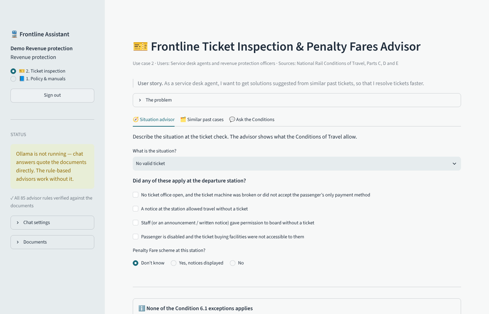

# Frontline Assistant — Thameslink policy chatbot (MVP)

A local, open-source assistant for Thameslink / GTR staff with **five use cases**. Each one combines:

- a **RAG chat** (retrieval-augmented generation) that searches only that use case's documents and answers **only from them, citing the document, section and page**, and
- for use cases 2–5, a **rule-based advisor**: staff describe the situation in a form and get the applicable rules, each linked to the exact wording of its Condition or section.

Staff **sign in**, and each user group lands in its own area and sees only the assistants for its role. An administrator manages accounts.

Everything runs on your own machine: no cloud AI service and no data leaving the computer, which matches the customer's on-premise requirement.



## The five use cases

Choose the assistant in the sidebar.

| # | Assistant | Users | Searches | Tools |
| --- | --- | --- | --- | --- |
| 1 | 📘 General Policy & Manuals Query Assistant | Frontline staff, customer service | All four documents | Chat |
| 2 | 🎫 Ticket Inspection & Penalty Fares Advisor | Service desk, revenue protection | Conditions of Travel Parts C–E | Situation advisor (Conditions 6, 8, 9, 10, 14, 15, 16) · similar past cases · chat |
| 3 | ♿ Passenger Assist & Accessibility Coordinator | Assisted travel coordinators | Accessible Travel Policy, Making Rail Accessible | Request checker (notice, mobility-aid limits, unstaffed stations, luggage, disruption) · chat |
| 4 | 💷 Disruption & Delay Repay Claims Specialist | Customer relations | Conditions of Travel Parts E–F | Claim checker (refund vs compensation, 60-minute rule, 50% minimum, 28-day deadlines) · data & privacy panel · chat |
| 5 | 🚆 Fleet Accessibility & Rolling Stock Advisor | Station managers, dispatch | Fleet table + related policy sections | Train profile · compare trains · feature finder · chat |

**How the advisors stay correct.** Every rule in `rag/advisors.py` quotes the exact phrase from the document it relies on (85 quotes). When the app starts, and in the tests, each quote is looked up in the indexed documents. If a document is updated and a rule no longer matches, the sidebar shows a warning instead of the app silently giving outdated advice. The advisors work without any language model.

**Similar past cases (use case 2).** Staff can save resolved cases (situation, decision, Conditions). New cases are matched against saved ones with the same keyword search. It starts with five **fictional** example cases (`data/caselog_examples.jsonl`), always labelled "Example" in the app; real cases are stored in `data/caselog.jsonl` on the server. Do not store passenger names.

## Sign-in and user groups

| Role | User group | Lands on | Can also open |
| --- | --- | --- | --- |
| Frontline staff | Frontline employee / customer service agent | 1 Policy & manuals | — |
| Revenue protection | Service desk agent / revenue protection officer | 2 Ticket inspection | 1 |
| Assisted travel | Resource planner / assisted travel coordinator | 3 Passenger Assist | 1 |
| Customer relations | Customer relations agent | 4 Refunds & compensation | 1 |
| Station management | Station manager / dispatch operator | 5 Fleet accessibility | 1 |
| Administrator | IT / data protection lead | Administration | all five |

Everyone can also use the general policy assistant (1), since all staff need it. Change the mapping in `ROLES` in `rag/auth.py`.

**Managing accounts.** Create the first administrator on the server, then manage everyone else in the app (Administration → Users: add, change role, disable, reset password):

```bash
python -m rag.auth create-admin itlead           # asks for a password
python -m rag.auth add jsmith --role revenue --name "Jo Smith"   # prints a temporary password
python -m rag.auth list
```

**Security measures in this prototype**
- Passwords are stored only as salted **scrypt** hashes; new and reset accounts get a random temporary password that must be changed at first sign-in. Minimum 10 characters, letters plus a number or symbol, not containing the username.
- **Lockout** for 15 minutes after 5 failed attempts; failed sign-ins don't reveal whether a username exists.
- **Access is checked on the server** for every page, not only hidden in the menu; disabling an account or changing its role takes effect at the user's next click.
- Automatic **sign-out after 30 minutes** without activity.
- **Audit log** of sign-ins, sign-outs and account changes (no passwords), visible to administrators.
- Accounts, audit log, feedback and saved cases are written to the **state folder** (`RAG_STATE_DIR`, default `data/`), separate from the documents. Back it up and keep it out of Git.

**Not production-ready yet (say so in the report):**
- For real use, connect to Thameslink's **single sign-on** (e.g. Microsoft Entra ID) instead of local accounts. Streamlit has built-in OpenID Connect sign-in (`st.login`) that can replace the local login page, while the role mapping stays the same.
- Serve the app over **HTTPS** behind a reverse proxy (e.g. nginx or IIS) on the intranet. Streamlit itself serves plain HTTP.
- Reloading the browser tab signs the user out: the sign-in lives in the browser session.
- Local accounts suit a pilot with a handful of users, not hundreds.

## Public demo on Streamlit Community Cloud

1. Sign in at <https://share.streamlit.io> with GitHub and click **Create app** → **Deploy a public app from GitHub**.
2. Repository: this repo · Branch: `main` · Main file path: `app.py` · choose an App URL.
3. **Advanced settings**: Python 3.12, and under **Secrets** paste:
   ```toml
   DEMO_MODE = "1"
   ```
4. **Deploy**. On first start the app downloads the documents (if they are not in the repo), builds the search index and creates one demo account per user group, listed on the sign-in page.

On Community Cloud there is no local language model, so the chat runs in "quote documents only" mode; the advisors work fully. The server's storage is temporary: accounts and saved cases are reset when the app restarts, and the demo accounts then get new passwords. In demo mode, visitors can't reset or disable the demo accounts.

## Run as a web app on a server

`Dockerfile` and `docker-compose.yml` run the app and Ollama together on one on-premise server:

```bash
docker compose up -d --build
docker compose exec ollama ollama pull llama3.1:8b
docker compose exec ollama ollama pull nomic-embed-text
docker compose exec app python -m rag.ingest --embed
docker compose exec app python -m rag.auth create-admin itlead
```

The app listens on `127.0.0.1:8501` on the server; publish it to staff through an HTTPS reverse proxy. Accounts and logs persist in `./state`. **These Docker files were written but not built in the environment where this prototype was made** (Docker Hub was not reachable there), so do a test build before relying on them. Without Docker, the Quick start commands work on any server with Python 3.10+, plus Ollama installed separately.

## Documents

| Document | Publisher | Version | Passages |
| --- | --- | --- | --- |
| National Rail Conditions of Travel | Rail Settlement Plan Ltd | Version 6, from 23 Nov 2025 | 90 |
| Accessible Travel Policy | GTR | April 2026 | 71 |
| Making Rail Accessible | GTR | April 2026 | 39 |
| Fleet Accessibility Information | GTR | April 2026 | 6 |

---

## Quick start (5 minutes, no AI model needed)

Requires **Python 3.10 or newer**.

```bash
cd thameslink-rag
python -m venv .venv
# Windows:  .venv\Scripts\activate      macOS/Linux:  source .venv/bin/activate
pip install -r requirements.txt

python -m rag.ingest          # read the PDFs and build the search index (~15 s)
python -m rag.auth demo       # one demo account per user group
python -m streamlit run app.py   # opens http://localhost:8501
```

The sign-in page has a **Demo accounts** dropdown: pick a user group to see its username and password (with copy buttons), or click **Fill in the sign-in form**. Demo passwords can't be changed from the app, so a shared demo keeps working.

- New demo passwords: `python -m rag.auth demo --reset`
- Hide the dropdown: set `DEMO_LOGINS=0`, or delete `demo_credentials.json` from the data/state folder
- If you publish the app online, anyone can use the listed accounts, including `demo.admin` (which can manage users). Disable that account in the admin area if you don't want visitors to have it. Before any real use, remove all demo accounts.

Without a language model the app runs in **"quote documents only"** mode: it finds the right passages and shows the most relevant sentences with citations. This is also the search-only baseline for the evaluation.

## Full RAG mode (local language model with Ollama)

1. Install **Ollama**: <https://ollama.com/download> (Windows, macOS, Linux).
2. Download a chat model and an embedding model (about 5 GB in total):
   ```bash
   ollama pull llama3.1:8b
   ollama pull nomic-embed-text
   ```
3. Add semantic search, then start the app:
   ```bash
   python -m rag.ingest --embed
   streamlit run app.py
   ```

The sidebar shows a green status when the model is connected. `llama3.1:8b` needs about 8 GB of free RAM. On a weaker laptop use a smaller model:

```bash
ollama pull llama3.2:3b
CHAT_MODEL=llama3.2:3b streamlit run app.py          # Windows PowerShell: $env:CHAT_MODEL="llama3.2:3b"
```

All settings (model names, Ollama address, passage size, number of passages) are in `rag/config.py` and can be overridden with environment variables.

You can also use the terminal: `python -m rag.cli "Can a passenger take a bicycle on the train?"` (add `-v` to see the passages).

---

## How it works

```
 PDFs ──► ingest ──► 206 passages ──► index (BM25 keywords + optional embeddings)
                                              │
 staff question ──────────────────────────────┤
                                              ▼
                              top 5 passages (hybrid search, rank fusion)
                                              │
                         ┌────────────────────┴───────────────────┐
                         ▼                                        ▼
            local LLM via Ollama                     no LLM: extractive answer
       (answers only from passages,                 (best-matching sentences,
        cites [1] [2], or says                       refuses when coverage is low)
        "I can't find this")
                         └────────────────────┬───────────────────┘
                                              ▼
                        answer + sources (document · section · page) + 👍/👎
```

| Step | File | What it does |
| --- | --- | --- |
| Ingest | `rag/ingest.py` | Reads each PDF line by line and uses **font size and bold text to find headings**, so each passage knows its section (e.g. *Condition 30.2*, *A.5 Wheelchairs, Scooters and mobility aids*). Splits text into passages of ~160 words that never cross a heading. Skips cover/contents pages, page numbers and decorative text. |
| Table data | `data/curated/fleet_accessibility.csv` | The one-page fleet table is a grid that PDF extraction scrambles, so it was **transcribed by hand** into a CSV (one passage per train class). Check it against the PDF if the document is updated. |
| Search | `rag/retrieve.py` | **BM25** keyword search (with stemming and a small list of rail synonyms) plus optional **semantic search** with `nomic-embed-text` embeddings, merged with **reciprocal rank fusion**. |
| Answer | `rag/answer.py` | Sends the top passages to the local model with strict rules: answer only from the sources, cite every statement, say "I can't find this in the documents I have" otherwise. Without a model: quotes the best sentences and refuses when the question's key words (or their synonyms) are not in any of the top three passages. |
| Use cases | `rag/usecases.py` | Users, problem, user story, **search scope** (which documents/sections each assistant may use) and the assistant's role in the prompt. |
| Advisors | `rag/advisors.py` | Rule-based checks for use cases 2–5; every rule cites an exact quote, verified against the documents. |
| Case log | `rag/caselog.py` | Saving and finding similar past cases (use case 2). |
| Sign-in | `rag/auth.py` | Accounts, roles, password hashing, lockout, audit log; command line for account management. |
| Interface | `app.py` | Streamlit web app: sign-in, one area per role, the advisors, chat with sources, 👍/👎 feedback, and the Administration area (users, activity, feedback, saved cases, system status). |
| Evaluation | `eval/` | 32 test questions with expected sources and answer facts; computes the metrics below. |
| Tests | `tests/` | 45 automated tests (`python -m pytest -q`): ingestion, search, every advisor rule and its citation, each use case's scope and example questions, the case log, sign-in (hashing, lockout, roles, audit log), and a **fake Ollama server** (`tests/mock_ollama.py`) that exercises the full LLM path without downloading a model. |

To add a document: put the PDF in `data/raw/`, add an entry to `data/documents.yaml`, run `python -m rag.ingest` (add `--embed` if using Ollama).

---

## Evaluation

```bash
python -m eval.evaluate          # retrieval + extractive answers
python -m eval.evaluate --llm    # also grades the language model's answers (Ollama must be running)
```

The report goes to `eval/results/report.md`. `eval/questions.yaml` has **26 answerable questions** (phrased the way staff might ask, in different words from the documents) and **6 out-of-scope questions** that should be refused (e.g. "What time is the last train from Brighton tonight?", "How much Delay Repay for a 15-minute delay?").

**Baseline results (keyword search only, no language model):**

| Metric | Result |
| --- | --- |
| Correct passage ranked first (Hit@1) | 62% |
| Correct passage in top 3 / top 5 | 92% / 92% |
| Mean reciprocal rank | 0.75 |
| Extractive answer contains the required facts | 88% |
| Extractive answer cites a correct passage | 85% |
| Answerable questions wrongly refused | 8% (2 of 26) |
| Out-of-scope questions correctly refused | 100% (6 of 6) |

**Important caveats for the report:**
- These numbers are **optimistic**. The synonym list and the refusal threshold (`MIN_COVERAGE = 0.40`) were tuned while looking at these same questions. The margin is thin: the highest-scoring out-of-scope question scores 0.39. Write a **separate held-out test set**, ideally with questions from real Thameslink staff, and report results on that.
- The language-model results have **not been measured yet**: the MVP was built in an environment where models could not be downloaded. The LLM path is tested end to end with the fake server, so it works mechanically, but its answer quality is your first experiment. Run `python -m eval.evaluate --llm` and compare against the baseline above.
- The automatic grading uses keyword patterns. Read the answers too (`eval/results/per_question.csv`): a correct-looking answer can still be misleading.

---

## Fit with CRISP-DM

| Phase | In this project |
| --- | --- |
| Business understanding | Use case: fast, consistent, traceable answers for frontline staff under pressure. Success = correct cited answers + honest refusals. |
| Data understanding | Four public documents, ~32,000 words; mixed layouts (numbered conditions, display headings, one table). |
| Data preparation | Heading-aware chunking, page/section metadata, hand-curated fleet table, removal of decorative text. |
| Modeling | BM25 baseline → hybrid search → local LLM generation. Compare chat models (e.g. `llama3.1:8b` vs `llama3.2:3b` vs `qwen2.5:7b`). |
| Evaluation | `eval/evaluate.py`: retrieval Hit@k/MRR, answer correctness, citation accuracy, refusal behaviour. |
| Deployment (concept) | On-premise server (Docker: app + Ollama) behind an HTTPS proxy; sign-in by role, later via Thameslink's single sign-on; 👍/👎 feedback and saved cases reviewed by an administrator. |

## Known limitations

- **Prototype, not for operational use.** Staff must verify answers against the cited document.
- Answers can only be as current as the PDFs; there is no automatic update when Thameslink publishes a new version.
- Station-specific facts (lifts, staffing hours at a given station) are mostly **not** in these documents; the assistant should refuse rather than guess.
- Page numbers are PDF page numbers, which may differ by one or two from the printed numbers in the documents.
- **Use case 3** checks a request against the policy, but does not match requests to available staff ("find suitable candidates"): that needs rostering data we do not have.
- **Use case 4** computes the Conditions' **minimum** compensation (50% for 60+ minutes). Thameslink's Delay Repay amounts for shorter delays are in its Passenger's Charter, which is not in the document set; the checker says so instead of guessing.
- **Use case 5**: the fleet table has no data on induction loops, number of wheelchair spaces or carriage positions.
- The advisors restate the documents for common situations; unusual cases still need a person's judgement.

## Ideas for next iterations

1. Measure the LLM path and compare 2–3 chat models (quality vs speed on a laptop).
2. Held-out test set written with Thameslink staff; add questions they actually get.
3. Add Thameslink's Delay Repay web page and the Passenger's Charter (after checking permission).
4. Show the exact sentence that supports each citation, highlighted in the passage.
5. Review 👎 feedback weekly: the human-in-the-loop quality process.

## Sources and permissions

The documents are published publicly by their owners and are credited in the app. *National Rail Conditions of Travel* © Rail Settlement Plan Ltd 2025; *Accessible Travel Policy*, *Making Rail Accessible* and *Fleet Accessibility Information* © Govia Thameslink Railway. They are used here for a non-commercial university prototype; **confirm with Thameslink (Steven) that this use is fine**, and do not publish the PDFs in a public repository.
