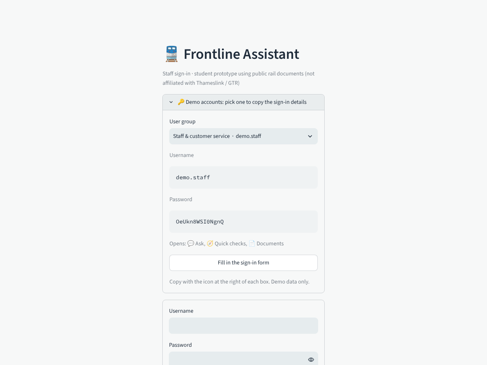

# Frontline Assistant v2: on-premise chatbot for Thameslink frontline staff

**Use case 1: frontline knowledge base.** Station teams, conductors, revenue protection officers and customer relations agents ask questions in plain language and get answers **only from the policy documents**, citing **document, section and page**, or an honest "I can't find this". The policy owner keeps the documents current and checks what the chatbot says; IT & data protection control access, logs and recovery. Everything runs on the company's own server: no cloud AI, no data leaves the company.

> Student prototype for the MPMD 3.1 Project Management and Data Analytics Lab (HTW Berlin). Uses only publicly published documents. Not affiliated with or endorsed by Thameslink or Govia Thameslink Railway. Not for real customer advice.



## What changed in version 2

Version 1 had five assistants for five user groups. Version 2 follows the user stories from status meeting 1: **three user groups**, and new features for the policy owner and for IT & data protection.

| User group | Area in the app |
| --- | --- |
| **Staff & customer service** (station teams, conductors, revenue protection, customer relations) | 💬 Ask · 🧭 Quick checks (tickets, assistance, refunds, trains) · 📄 Documents |
| **Policy owner** | Everything staff have, plus 🗂️ Manage documents · 🔍 Check answers · 🧪 Test set |
| **IT & data protection** | 👥 Accounts · 📜 Activity & logs · 🔒 Privacy & on-premise · 💾 Backups & recovery · 🛠️ System |

Changing documents needs the policy-owner role **and** the named *document editor* right. IT creates accounts but cannot give that right; only an existing document editor can (separation of duties).

## User stories and how they are met

Every story has an automated acceptance test in `tests/test_user_stories.py` (named after the story).

**Staff and customer service**

| Story | Acceptance criteria | In the app |
| --- | --- | --- |
| Citations | Policy and section in every answer; link to the source; no unsupported answer | Each source shows document, section, pages and version, with an **Open PDF** button. If no passage fits, the answer is "I can't find this in the documents I have." |
| Refunds and disruption | Answer cites the relevant Condition; same question gives the same answer | Search is deterministic; the language model runs at temperature 0 with a fixed seed. |
| Tickets on board | Answer within the agreed response time; cites the Conditions of Travel | Each answer shows its time against the target set by IT; the IT area shows the median and 95th percentile. Quick checks for ticket situations. |
| Assistance | Cites the Accessible Travel Policy; says "not found" when not covered | "Assistance" search topic; assistance quick check. |

**Policy owner**

| Story | Acceptance criteria | In the app |
| --- | --- | --- |
| Upload and replace | Indexed without developer help; old version no longer used; clear error if the upload fails | **Manage documents → Upload or replace**. Checks the file (PDF, size, readable text, not password-protected), indexes it, and replaces the old version's passages. A failed update is undone automatically. |
| Document overview | Title, version, pages and last update per document; starts with the 4 documents | **Manage documents → Overview** |
| Remove | Removal must be confirmed; no passage from it is cited afterwards | Type the document's short name to confirm. Quick-check rules that quoted a removed document show "being reviewed" instead of the rule. |
| Check answers | The passage used is shown; the test set is rerun after every change | **Check answers** shows each passage with its search ranks. The **test set** reruns automatically after every upload or removal, and results are kept. |
| Control | Only named users change documents; every change is logged | Document editor right, checked on the server; **Change history** tab. |

**IT and data protection**

| Story | Acceptance criteria | In the app |
| --- | --- | --- |
| Local processing | The full workflow works with external network access blocked; no external calls found | A **network guard** inside the app refuses connections outside the local network. **Run the on-premise check** answers a question with the guard in blocking mode and reports any attempt. |
| Access control | An employee account fails on every admin-only action | Permissions are checked in the functions themselves, not only in the menu; refusals go to the audit log. |
| Conversations | Two sessions cannot see each other's chats; no history unless agreed | Chats live in the browser session only. IT can allow kept histories; each user then decides for themselves, and only they can read or delete theirs. |
| Logging | After a test chat, logs contain no passwords or unneeded chat content | The request log holds role, topic, time and outcome only: no username, question or answer. Feedback includes the question only if staff tick "share". Retention periods are set by IT, and expired entries are deleted daily. |
| Deletion | After removal, its text and search entries are gone | Removal deletes the file, passages, embeddings, copies in restore points and kept chat histories, then checks for leftovers. |
| Maintenance | A working version can be restored after a failed update | A restore point is taken before every document change; **Backups & recovery** restores one. Recovery steps are in `RECOVERY.md`, which is also shown in the app. |

Risk mitigations from the risk register that are built in: R1 hallucination (answer only from passages, "not found"), R2 outdated documents (version shown with every source; replace in the app), R5 wrong permissions, R6 prompt injection (sources are fenced and treated as data; only document editors can upload), R7 slow responses (response-time monitoring; quick checks), R8 downtime (Open PDF fallback; restore points), R11 over-trust (visible sources; "the decision stays with you"), R12 governance (named editors, audit log), R13 weak testing (test set including unanswerable questions).

## Quick start (no AI model needed)

Requires **Python 3.10 or newer**.

```bash
pip install -r requirements.txt
python scripts/download_documents.py   # only if data/raw has no PDFs
python -m rag.ingest                   # copies data/ into library/ and builds the search index
python -m rag.auth demo                # demo.staff, demo.policy (document editor), demo.it
python -m streamlit run app.py         # http://localhost:8501
```

The sign-in page has a **Demo accounts** dropdown with copyable usernames and passwords. New demo passwords: `python -m rag.auth demo --reset`.

**Upgrading from version 1:** version 1 kept accounts in `data/`; version 2 keeps them in `state/`. Run `python -m rag.auth demo` again after updating.

Without a language model the app answers by quoting the best-matching sentences, with their sources. To use a local model, install [Ollama](https://ollama.com/download), then run `ollama pull llama3.1:8b` and `ollama pull nomic-embed-text`, and start the app; the sidebar shows when the model is connected.

## Where things are stored

| Folder | Contents | In Git? |
| --- | --- | --- |
| `data/` | The four documents shipped with the app (read-only) | yes |
| `library/` (`RAG_DATA_DIR`) | The document library the app uses and policy owners change: documents.yaml, PDFs, search index | no |
| `state/` (`RAG_STATE_DIR`) | Accounts, audit and request logs, settings, test set and runs, restore points, kept chat histories | no |

## Run on a server (Docker)

```bash
docker compose up -d --build
docker compose exec ollama ollama pull llama3.1:8b
docker compose exec ollama ollama pull nomic-embed-text
docker compose exec app python -m rag.auth create-admin itlead
docker compose exec app python -m rag.auth add policylead --role policy_owner --editor
```

The library and all state live on the `./state` volume; back it up (see `RECOVERY.md`). The app listens on `127.0.0.1:8501`; publish it to staff through an HTTPS reverse proxy. The Docker files have not been test-built yet. For real use, replace local accounts with the company's single sign-on (Streamlit's `st.login` supports OpenID Connect), and block outgoing traffic in the server firewall as well.

## Public demo (Streamlit Community Cloud)

Deploy `app.py` with Python 3.12 and the secret `DEMO_MODE = "1"`. On first start the app builds the library and creates the three demo accounts. In demo mode the four original documents cannot be removed or replaced, demo accounts cannot be reset or disabled, and the network guard only records connections (it doesn't block them). Storage is temporary: uploads, accounts and logs reset when the app restarts.

## How it works

```
PREPARE (once, and whenever a document changes)
 policy documents ──► split into passages by heading ──► search index (keywords + optional meaning)
                      (section and page kept)            + restore point + test set rerun
ANSWER (every question)
 staff question ──► best 5 passages ──► local LLM (or quoted sentences) ──► answer + document, section, page
```

| Part | File |
| --- | --- |
| Reading PDFs, heading-aware passages | `rag/ingest.py` |
| Document library: upload, replace, remove, restore points | `rag/library.py` |
| Search: BM25 + rail synonyms, optional embeddings, rank fusion | `rag/retrieve.py` |
| Answers with citations, "not found", fenced sources | `rag/answer.py` |
| Quick checks (85 rules, each quoting its source, checked against the documents) | `rag/advisors.py` |
| Accounts, roles, permissions, audit log | `rag/auth.py` |
| Request log, feedback, retention | `rag/usage.py` |
| Opt-in chat history | `rag/history.py` |
| Network guard | `rag/netguard.py` |
| Test set and runs | `rag/testset.py` |
| IT settings | `rag/settings.py` |
| Web app | `app.py` |

The slides mention a vector database such as ChromaDB. With about 200 passages, the embeddings are kept as a single matrix next to the index, which does the same job with nothing extra to install. A vector database becomes worthwhile at tens of thousands of passages.

## Evaluation

`python -m eval.evaluate` (add `--llm` to grade the language model). The policy owner's **Test set** area runs the same 32 questions (26 answerable, 6 out of scope) and can add more.

| Metric (keyword search, quoted answers) | Result |
| --- | --- |
| Correct passage first / in top 3 | 62% / 92% |
| Answer contains the required facts | 92% (24 of 26) |
| **Wrong answers** (target: none) | **0** |
| Answerable questions answered "not found" | 2 of 26 |
| Out-of-scope questions correctly refused | 6 of 6 |

These numbers are optimistic: the synonyms and the refusal threshold were tuned on the same questions. Add 5–10 real staff questions in the Test set area and report results on those. The language-model answers have not been measured yet.

## Tests

`python -m pytest -q` runs 66 tests: one acceptance test per user story, plus ingestion, search, every quick-check rule and its citation, sign-in, and a fake Ollama server for the language-model path.

## Known limitations

- Prototype: staff must check answers against the cited source.
- Page numbers are PDF page numbers, which can differ slightly from the printed ones.
- Station-specific facts (lifts, staffing hours) are mostly not in these documents; the assistant says "not found".
- Scanned PDFs need text recognition before upload.
- The fleet table was transcribed by hand from the PDF; if GTR updates it, the CSV must be updated too.
- The network guard is a safety net inside the app, not a firewall.

## Sources and permissions

*National Rail Conditions of Travel* © Rail Settlement Plan Ltd 2025; *Accessible Travel Policy*, *Making Rail Accessible* and *Fleet Accessibility Information* © Govia Thameslink Railway. All four are published publicly; they are used here for a non-commercial university prototype. Confirm with Stefan that this use is fine, and keep the PDFs out of public repositories.
